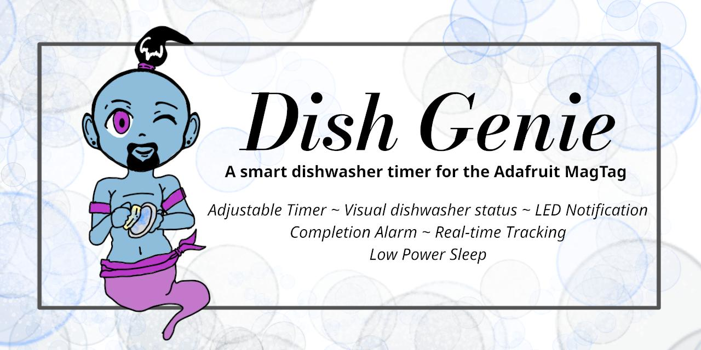

Dish Genie is a simple but fun MagTag project that lets you set a timer for your dishwasher cycle and get notified when it’s done — complete with custom e-Ink graphics, NeoPixel LED feedback, and button-driven control.

---

## ✨ Features
- 🕒 **Adjustable timer** — Increase timer by 30-minute increments, or reset to default (1 hour). In either 12 or 24 hour format!
- 😴 **Sleeping screen** — Before deep sleep (while the timer runs or after the clean jingle), the display shows “Sleeping” so the idle state is obvious; press **A** (labeled “Wake”) to return home after a cycle completes.
- 🧽 **Visual dishwasher states** — “Dirty”, “Cleaning…”, and “Clean!” screens with custom BMP images.
- 💡 **LED notifications** — MagTag’s built-in NeoPixels blink in different colors for each state.
- 🔔 **Completion alert** — Audible jingle plays when the cleaning timer finishes.
- 🌐 **Real-time tracking** — Fetches the current time from Adafruit IO’s time integration.
- 🔋 **Low power sleep** — Uses `alarm` deep-sleep to conserve power between cycles.

---

## 🧩 How It Works

1. On boot, the MagTag displays the Home screen (Dish Genie logo).
2. Press the **Cleaning** button to start the dishwasher timer.
3. The device fetches the current time via Adafruit IO and calculates the estimated finish time.
4. The MagTag goes into deep sleep until the timer expires (or a button is pressed).
5. When the timer ends, LEDs flash yellow, a tone plays, and the Clean! screen appears.

> *Rename `secrets.EXAMPLE.py` to `secrets.py` and fill in with your Network/AIO settings to fetch time.*

---

## 🧰 Hardware Requirements
- [Adafruit MagTag](https://www.adafruit.com/product/4800)
- USB-C cable for programming/power
- Optional: 3D-printed stand or magnetic mount for your dishwasher door

---

## 💾 Software Requirements
- **CircuitPython 10.0+**
- **Libraries:**
  - `adafruit_magtag`
  - `adafruit_requests`
  - `adafruit_io`
  - `wifi`
  - `alarm`
  - `socketpool`
  - `displayio`
  - `terminalio`

You can install these from the [Adafruit CircuitPython Bundle](https://circuitpython.org/libraries).

---

## 💤 Power & Sleep
- Uses alarm.exit_and_deep_sleep_until_alarms() to conserve battery life.
- Can be woken early by pressing Button A or B.
- Automatically stores the last timer duration in timer.txt for next use.

---

## 🔧 Issues/Notices
> - Untested with 2025 version of the MagTag, but should all work the same.
> - PRs welcome!

---

## 📃 License
Copyright © 2025 Adam Neighbors

Released under the GNU General Public License v3.0 (GPLv3).
See the [LICENSE](LICENSE) file for details.
